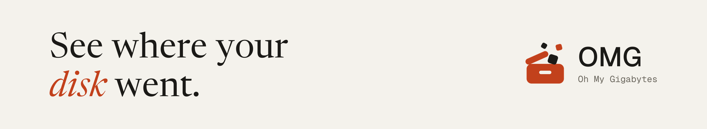

<p align="center">
  
</p>

<p align="center">
  <a href="https://www.npmjs.com/package/oh-my-gigabytes"></a>
  <a href="https://github.com/akramcodez/oh-my-gigabytes/actions/workflows/check.yml"></a>
  
  <a href="#license"></a>
</p>

<p align="center">
  <a href="https://www.oh-my-gigabytes.com"><b>Website</b></a> ·
  <a href="https://www.npmjs.com/package/oh-my-gigabytes">npm</a> ·
  <a href="https://github.com/akramcodez/oh-my-gigabytes/releases">Releases</a> ·
  <a href="CHANGELOG.md">Changelog</a> ·
  <a href="docs/safety.md">Safety rules</a>
</p>

**OMG (Oh My Gigabytes)** shows where your disk space went and helps you take it back. It scans file metadata on your machine, explains which caches, build folders and leftovers take space, and deletes only what you confirm. Nothing is uploaded.

> [!WARNING]
> **`0.2.0` is a development preview.** Delete is permanent. Read [Deleting files](#deleting-files) first.

## Features

- **Finds developer clutter:** package caches, build output, old toolchains and IDE versions, AI tool sessions, models, Docker leftovers and large files.
- **Explains every finding:** what it is, why it can go, and when it last changed.
- **You decide:** suggestions go to OMG Trash, a saved list. Nothing is deleted until you confirm.
- **Safe by default:** home folder only; keys, credentials, databases, `.git` and active repositories are never deleted.
- **Fast and local:** a Rust scanner reads names, sizes and times, never file contents.

## Quick start

Needs Node 22 or newer.

```sh
npm install --global oh-my-gigabytes
omg
```

The first launch scans your home folder. On macOS, give your terminal Full Disk Access in System Settings › Privacy & Security so it can read Desktop, Documents and Downloads.


## Keys

| Key | Does |
| --- | --- |
| `1` to `5` | Overview, Browse, Findings, OMG Trash, Deleted |
| `↑` `↓` or `j` `k` | Move; `⏎` opens, `⌫` goes back |
| `␣` | Add to OMG Trash |
| `d` / `D` | Delete the selected item / everything in OMG Trash, after a confirmation |
| `r` | Scan again |
| `m` | Options: auto delete, Docker cleanup, suggestions, theme |
| `?` / `q` | All shortcuts / quit |

## Commands

```sh
omg scan --root ~/code               # scan a folder
omg status                           # totals
omg findings                         # what can be cleaned, and why
omg grew                             # folders that grew since the last scan
omg tree ~/Library                   # largest folders and files under a path
omg clean --category logs_and_temp   # preview; add --confirm <fingerprint> to delete
omg docker clean                     # unused Docker data, removed by Docker itself
omg doctor                           # health check
```

`omg --help` lists every command.

## Deleting files

- `d` deletes the selected item and `D` everything in OMG Trash, after a confirmation that shows the exact paths and size. **There is no undo.**
- omg re-checks each item right before deleting it and skips anything that changed.
- **Never deleted:** anything outside your home folder, credentials, keys, databases, `.git`, `.ssh`, cloud-synced folders, active Git repositories and VM disks.
- **Auto delete** is off by default. Turn it on from the options menu (`m`) or with `omg auto-delete on --every 7`; it deletes only what stayed unchanged in OMG Trash for that long.

## Platforms

| System | Scans | Deletes on |
| --- | --- | --- |
| Linux x86_64, ARM64 (glibc 2.28+, kernel 5.6+) | ext4, XFS, Btrfs, tmpfs | ext4, Btrfs, tmpfs |
| Windows 11 x64 | NTFS, ReFS | NTFS |
| macOS 15+ on Apple silicon | APFS, HFS+, exFAT, FAT | APFS |

Test records: [Linux](docs/linux-qualification.md), [macOS](docs/macos-evidence.md), [Windows](docs/windows-evidence.md).

## Uninstall

```sh
omg auto-delete off
omg schedule disable        # macOS, Windows
omg service uninstall       # Linux
npm uninstall --global oh-my-gigabytes
```

## Development

Rust 1.95.0 and Node 22+:

```sh
cargo test --workspace --locked
cargo run -p omg-cli -- --state-dir /tmp/omg-state scan --root /path/to/dir
```

More in [CLAUDE.md](CLAUDE.md), [safety rules](docs/safety.md), [release process](docs/release.md) and [SECURITY.md](SECURITY.md).

## License

MIT OR Apache-2.0, at your option. Made by [@akramcodez](https://github.com/akramcodez).
